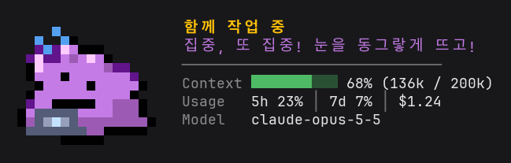

# Claude with Ditto

<p align="center"><a href="README.md">English</a> | <b>한국어</b></p>

메타몽이 프롬프트 위에서 작업 상태를 표정으로 알려 주는 Claude Code Mods입니다. 터미널(CLI)과 Claude Desktop의 Code 탭에서 모두 동작합니다.



## 설치

**Claude Code**

```text
/plugin install ditto --marketplace 4anghyeon/claude-with-ditto
```

**Shell**

```sh
claude plugin install ditto --marketplace 4anghyeon/claude-with-ditto
```

**Desktop App**
- 입력창 옆 + 버튼 → Plugins → Add marketplace에 `4anghyeon/claude-with-ditto` 추가 → Add plugin

## 업데이트

마켓플레이스 목록을 새로 받은 뒤 모드를 업데이트합니다.

```sh
claude plugin marketplace update claude-with-ditto
claude plugin update ditto@claude-with-ditto
```

이미 열려 있는 세션에는 `/reload-plugins`를 입력하거나 다시 시작하면 새 버전이 적용됩니다.

## 제거

**Mods**

```sh
claude plugin uninstall ditto@claude-with-ditto
```

**Marketplace**

```sh
claude plugin marketplace remove claude-with-ditto
```

## 기능

- 프롬프트 위에서 도트 메타몽이 움직입니다. 터미널에서는 반 칸 블록 문자, Desktop에서는 애니메이션 SVG로 그립니다.
- 작업 상태에 따라 표정이 바뀝니다.

  | 상태 | 모습 | 언제 | 움직임 |
  |---|---|---|---|
  | 대기 중 |  | 세션을 시작했을 때, 작업 완료 10초 뒤 | 눈을 깜박이다 가끔 두리번거리거나 하품하고, 1분이 지나면 돌로 변해 잠듦 |
  | 생각 중 |  | 프롬프트를 보냈을 때, 파일 읽기, 테스트 실행 | 통통 튀고 물음표가 뜸 |
  | 함께 작업 중 |  | 파일 수정, 그 밖의 명령 실행 | 노트북 앞에서 타이핑 |
  | 오류 발견 |  | 답변에 오류나 실패가 있을 때 | 물방울이 맺힘 |
  | 작업 완료 |  | Claude가 답을 마쳤을 때 | 별이 반짝임 |

- 메타몽 옆에는 지금 상태와 한마디가 뜹니다.
- 컨텍스트 사용량을 막대와 퍼센트로 보여 줍니다.
- 사용량 한도와 세션 비용을 보여 줍니다.
- 지금 쓰는 모델을 보여 줍니다.
- `/ditto <질문>`으로 메타몽에게 물어볼 수 있습니다. 질문은 지금 세션으로 바로 가고, Claude가 대화 맥락을 그대로 이어서 메타몽 말투로 답합니다.
- `/ditto mood <idle|thinking|working|error|done>`로 표정을 직접 바꿔 보고, `/ditto demo`로 다섯 표정과 도구별 소품 네 가지를 차례로 봅니다.

## 움직임

표정이 바뀔 때는 녹아내렸다가 다시 뭉칩니다.


대기 중에는 가끔 짧은 동작을 하고, 오래 두면 돌로 변신해 잠듭니다.

> 어떤 것이든 변신할 수 있다. 잘 때는 돌로 변신해서 공격받지 않도록 하고 있다.
>
> — 포켓몬 도감 (골드/하트골드)

| 두리번 | 흔들기 | 늘리기 | 하품 | 잠들기 |
|---|---|---|---|---|
|  |  |  |  |  |

도구를 쓰는 동안에는 소품을 듭니다.

| Read | Grep, Glob | Bash | 웹 검색 |
|---|---|---|---|
|  |  |  |  |

## 언어

`/ditto lang <auto|ko|en>`으로 바꿉니다. 바꾼 값은 `/config`의 Ditto `language` 항목에 저장되어 다음 세션에도 유지됩니다.

기본값 `auto`는 Claude Code 설정의 `language`를 따릅니다.

## 알아 둘 점

터미널에서는 줄 간격을 1.0으로 맞추고 블록 문자가 들어 있는 고정폭 글꼴(JetBrains Mono 등)을 쓰면 메타몽이 끊기지 않고 깔끔하게 보입니다.

## 요구 사항

- 모드를 지원하는 Claude Code 2.1.287 이상
- 대화형 CLI나 Claude Desktop의 Code 탭

## 검사와 실행

`claude-with-ditto/` 폴더가 있는 곳에서 실행합니다.

```sh
claude plugin validate ./claude-with-ditto
claude plugin test ./claude-with-ditto
claude --plugin-dir ./claude-with-ditto
```

## 보안

이 모드는 세션 이벤트를 보고 메타몽을 그리는 일 말고는 아래 세 가지만 합니다.

- `/ditto <질문>`을 입력하면 그 질문을 현재 세션에 보냅니다.
- 메타몽에게 온 질문에 메타몽 말투로 답하도록 시스템 프롬프트에 짧은 섹션을 붙입니다.
- `/ditto lang`을 입력하면 이 모드의 `language` 설정을 저장합니다.

사용자가 입력한 프롬프트는 건드리지 않고, 도구 실행을 막거나 대신 승인하지도 않습니다. 파일을 읽거나 쓰지 않고 네트워크 요청도 보내지 않습니다.

## 라이선스

코드는 [MIT 라이선스](LICENSE)를 따릅니다.

포켓몬과 메타몽의 이름, 모습, 이를 바탕으로 그린 스프라이트, 인용한 도감 문구는 Nintendo, Creatures, GAME FREAK의 것이며 이 라이선스에 포함되지 않습니다. 이 저장소는 이들과 관계없는 비공식 팬 프로젝트입니다.
