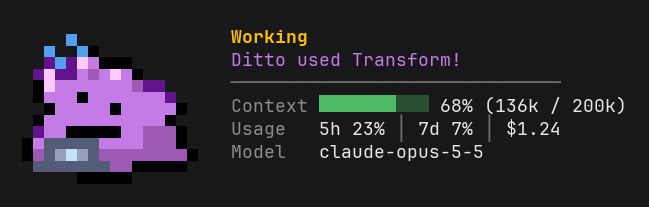

# Claude with Ditto

<p align="center"><b>English</b> | <a href="README.ko.md">한국어</a></p>

A Claude Code mod in which Ditto sits above the prompt and shows how the work is going. It runs in the terminal (CLI) and in the Code tab of Claude Desktop.



## Install

**Claude Code**

```text
/plugin install ditto --marketplace 4anghyeon/claude-with-ditto
```

**Shell**

```sh
claude plugin install ditto --marketplace 4anghyeon/claude-with-ditto
```

**Desktop App**
- + button next to the prompt box → Plugins → add `4anghyeon/claude-with-ditto` with Add marketplace → Add plugin

## Update

Fetch the latest marketplace list, then update the mod:

```sh
claude plugin marketplace update claude-with-ditto
claude plugin update ditto@claude-with-ditto
```

A session that is already running picks up the new version after `/reload-plugins` or a restart.

## Uninstall

**Mod**

```sh
claude plugin uninstall ditto@claude-with-ditto
```

**Marketplace**

```sh
claude plugin marketplace remove claude-with-ditto
```

## Features

- A pixel Ditto moves above the prompt. The terminal draws it with half-block characters, Desktop with an animated SVG.
- Its face follows the state of the work.

  | State | Looks | When | Motion |
  |---|---|---|---|
  | Idle |  | The session starts, 10 seconds after Done | Blinks, now and then looks around or yawns, and turns to stone to sleep after a minute |
  | Thinking |  | A prompt is sent, files are read, tests run | Hops, with a question mark |
  | Working |  | Files are edited, other commands run | Types on a laptop |
  | Error |  | The answer mentions an error or a failure | Breaks into a sweat |
  | Done |  | Claude finishes its answer | Sparkles |

- Next to Ditto are the state and a line from Ditto.
- Context usage is shown as a bar and a percentage.
- Rate limits and the session's cost are shown too.
- So is the model in use.
- `/ditto <question>` asks Ditto. The question goes straight to this session, and Claude answers in Ditto's voice with the conversation's context.
- `/ditto mood <idle|thinking|working|error|done>` sets a face by hand, and `/ditto demo` shows all five in turn, then the four tool props.

## Motion

When its mood changes, Ditto melts down and wells back up.


While idle it does a short action now and then, and turns to stone to sleep if left alone.

> It can transform into anything. When it sleeps, it changes into a stone to avoid being attacked.
>
> — Pokédex (Gold/HeartGold)

| Look around | Wiggle | Stretch | Yawn | Sleep |
|---|---|---|---|---|
|  |  |  |  |  |

While it uses a tool, it holds a prop.

| Read | Grep, Glob | Bash | Web search |
|---|---|---|---|
|  |  |  |  |

## Language

Change it with `/ditto lang <auto|ko|en>`. The value is saved in Ditto's `language` row in `/config` and kept for later sessions.

The default, `auto`, follows Claude Code's own `language` setting: Korean when it names Korean (`korean` and the like), English for any other language. With no such setting it looks at the `LANG` environment variable, and without that at the system language.

## Good to know

In the terminal, Ditto looks cleanest with a line height of 1.0 and a monospace font that has block characters (JetBrains Mono and the like).

## Requirements

- Claude Code 2.1.287 or later, with mod support
- The interactive CLI or the Code tab of Claude Desktop

## Check and run

Run these from the folder that holds `claude-with-ditto/`:

```sh
claude plugin validate ./claude-with-ditto
claude plugin test ./claude-with-ditto
claude --plugin-dir ./claude-with-ditto
```

## Security

Besides watching session events and drawing Ditto, the mod does only these three things:

- `/ditto <question>` sends the question to the current session.
- It adds a short section to the system prompt so that questions for Ditto are answered in Ditto's voice.
- `/ditto lang` saves the mod's own `language` setting.

It leaves the prompts you type alone and never blocks or approves tool runs. It reads and writes no files and makes no network requests.

## License

The code is under the [MIT License](LICENSE).

Pokémon, Ditto's name and likeness, the sprites based on it and the quoted Pokédex text belong to Nintendo, Creatures and GAME FREAK, and are not covered by this license (see [NOTICE](NOTICE)). This is an unofficial fan project, not affiliated with them.
